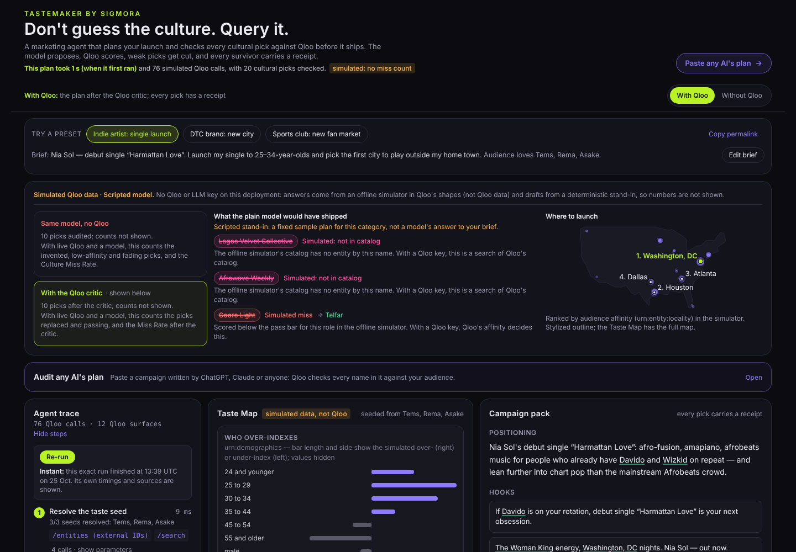

# Tastemaker by Sigmora

**Every marketing agent guesses the culture. Tastemaker checks it, then ships the campaign.**

Tastemaker is a marketing agent that plans a launch for a creator or small brand: audience, launch city, collaborators, brand partners, hook references, podcast pitches, venue, presenter, hooks, a 30-second script and captions per platform. It uses [Qloo](https://www.qloo.com/) as the **critic inside the agent loop**. The LLM proposes, Qloo scores every cultural pick against the target audience, low-affinity picks and names Qloo can't find are cut and replaced with Qloo-preferred alternatives, and every surviving pick carries a **receipt**: affinity score, which input drove it (explainability), trend direction, and the exact Qloo call behind it.

A **Without Qloo** toggle shows the plan the same model writes with no Qloo access, with its misses struck through.

> **Disclosure:** built for the [Qloo Agentic Hackathon](https://qloo.devpost.com/). All Qloo integration, the agent, the critic loop, the UI and the benchmark are new work in this repo (see [docs/new-work-disclosure.md](docs/new-work-disclosure.md)). Sigmora, the publishing engine behind "Ship", pre-existed and is reached only through a narrow `/v1` API.

**Live demo:** _being connected to hosting; see [BLOCKED.md](BLOCKED.md)._ · **Judge path:** [docs/judging.md](docs/judging.md) · **Benchmark:** [docs/benchmark.md](docs/benchmark.md)



_Screenshot from an offline run (`pnpm screenshots`): the one-line source note at the top of the diff card says the Qloo data is simulated and the model scripted, and the card hides its counts, as it does on any simulated or scripted run. On desktop, where to launch sits beside it, and the trace, Taste Map and pack start on the first screen._

## Why it matters

Tastemaker produces a checked launch plan (audience, city, references, assets, schedule) in one run, and shows you which of the AI's picks were wrong. LLM marketing agents *hallucinate culture*: they confidently pick artists, shows, brands and places an audience doesn't actually love, and sometimes ones that don't exist. Tastemaker measures that miss rate on every run and fixes it before anything ships.

## Try it in 10 seconds

Open the demo and click a preset:

1. **Indie artist: single launch.** An independent Afro-fusion artist picks the first US city to play.
2. **DTC brand: new city.** A clean-skincare brand opens a pop-up in Atlanta.
3. **Sports club: new fan market.** A football club picks its first US watch-party city.

Then flip **Without Qloo**, and click any receipt chip to see the Qloo call behind it.

**Audit any AI's plan.** Click **Paste any AI's plan →** at the top of the page (or open the panel under the diff card), paste a campaign that ChatGPT, Claude or anyone wrote (up to 4,000 characters), or click **Try a sample plan**, and the same Qloo critic judges every cultural name in it against the audience: names Qloo can't find, low-affinity and fading picks, each with a receipt and a Qloo-preferred replacement. With a live model configured, the model lists the names (`LiveLLM.extract`); offline, a deterministic scanner takes every name on a labelled line ("Collab targets: …"), invented ones included, plus other names Qloo knows by that exact name (`src/lib/agent/extract.ts`, `POST /api/audit`).

## How the agent works

```
resolve seeds ─► who over-indexes ─► taste vocabulary ─► cross-domain culture map
 (/search,         (urn:demographics)   (urn:tag)            (/v2/insights × 6 types)
  /entities)
      ─► where to launch ─► demand heatmap ─► venues in the city ─► rising vs fading
         (urn:entity:locality) (urn:heatmap)    (place + filter.location) (/v2/trending)
      ─► positioning gap ─► LLM drafts the campaign
         (/v2/analysis/compare)
      ─► QLOO CRITIC: resolve every named entity (typed, then untyped search; no match = not found in Qloo),
         score with filter.results.entities + feature.explainability,
         check venues are in the launch city, check hook references aren't fading
      ─► for each failure the model picks one of Qloo's above-bar options, or proposes its own idea,
         which the critic scores first and keeps only if it clears the bar
      ─► LLM revises the copy around the swaps ─► critic again (≤ 2 rounds)
      ─► pack with receipts ─► Ship (Sigmora /v1, sandbox on the public demo)
      ─► measure ─► re-query: picks named in the posts that beat the median engagement
         rate become the next run's seeds (signal.interests.entities)
```

Discovery is set to lean toward what's rising (`bias.trends` on artist, TV, film and podcast candidates; sent by default, but unverified on the hackathon host until the key lands, see [BLOCKED.md](BLOCKED.md) #15), and the taste vocabulary is spread across tag subtypes (`diversify.by=subtype` on `urn:tag`, its documented use). Trend-biased pools are re-scored with plain affinity, so the critic's pass bar and the pick scores are on the same scale, and scoring calls never carry either parameter.

The same model also drafts with no Qloo context; the critic audits that plan without fixing it, which powers the Without Qloo view and the Culture Miss Rate.

### Qloo surfaces used

| Surface | Job in Tastemaker |
|---|---|
| `GET /search` | Resolve seeds, candidate cities and every name the model writes; no match in a typed or an untyped search = not found in Qloo |
| `GET /entities` (`external.spotify.ids`, `external.imdb.ids`) | Seed from a pasted Spotify or IMDb link |
| `GET /v2/tags` (`feature.semantic_search=true`) | Map the brief's free-text vibe to real tag IDs, sent as `signal.interests.tags` |
| `/v2/insights` `urn:demographics` | Which age and gender buckets over-index |
| `/v2/insights` `urn:tag` | The audience's taste vocabulary, fed into the copy |
| `/v2/insights` artist · brand · tv_show · movie · podcast · person | Cross-domain culture map: collabs, partners, references, pitches, presenters |
| `/v2/insights` `urn:entity:locality` + `filter.results.entities` | Rank candidate launch metros |
| `/v2/insights` `urn:heatmap` + `filter.location` (US polygon) | Demand map; cells folded into each candidate city (fallback ranking) |
| `/v2/insights` `urn:entity:place` + `filter.location.query` | Venues in the launch city; venue-in-city check |
| `filter.results.entities` + `feature.explainability=true` | **The critic**: score the model's shortlist and attribute why |
| `GET /v2/trending` | Rising vs. fading references |
| `GET /v2/analysis/compare` | Positioning gap vs. a comparable's audience |
| `signal.demographics.age/gender` | Every call is conditioned on the target audience |

Every request is validated against a per-`filter.type` parameter allow-list before it leaves the server (Qloo silently drops unknown params), throttled under the key's rate limit (per server instance), retried with backoff on 429/5xx/timeouts, capped by a per-run and a daily call budget, cached by normalized request, and labeled in the UI as **live**, **replayed** (recorded fixture) or **simulated**. When a live call fails and an answer comes from a fallback, the trace and a banner say so and why.

## Use it from any agent (MCP)

Tastemaker is also an MCP server at `POST /api/mcp` (Streamable HTTP per the 2025-06-18 spec: stateless, one JSON-RPC message per POST, JSON responses). Two tools:

- `taste_check`: give it an audience (`seeds`, `ages`, optional `gender` and `city`) and a list of picks (artists, brands, shows, films, podcasts, venues, creators, cities); get back a verdict per pick (pass, low affinity, not found in Qloo, fading, unscored), the Qloo affinity, explainability, the calls behind it, and Qloo-preferred replacements. Input schemas are generated from the same zod schemas the server enforces.
- `plan_campaign`: the full agent, for a preset or a brief.

```bash
curl -s localhost:3000/api/mcp -H 'content-type: application/json' -d '{"jsonrpc":"2.0","id":1,"method":"tools/call","params":{"name":"taste_check","arguments":{"seeds":["Tems","Rema"],"ages":["25_to_29"],"picks":[{"name":"Nickelback","type":"artist","role":"collab"}]}}}'
```

Any MCP client that speaks Streamable HTTP can add it as a remote server, so Claude, ChatGPT or your own agent can "taste-check this campaign" before it ships.

## Run it locally (zero credentials)

```bash
pnpm install
pnpm dev            # http://localhost:3000, runs fully offline
pnpm demo           # the hero preset end to end in the terminal
pnpm test           # unit (incl. property-based with fast-check), integration, and end-to-end (stubbed live + record/replay)
pnpm test:e2e       # real Chromium at 390 px against `next dev`, no credentials (Playwright)
```

With no keys, Qloo answers come from an **offline simulator** (placeholder numbers in Qloo's response shapes, labeled "simulated" everywhere) and drafts come from a **scripted model**. Add keys in `.env.local` (see [.env.example](.env.example)):

| Variable | Effect |
|---|---|
| `QLOO_API_KEY` | Live Qloo (hackathon host). A failed live call falls back to a recorded live response with the reason shown in the trace; it never mixes in simulator data |
| `LLM_PROVIDER`, `LLM_MODEL`, `LLM_API_KEY`, `LLM_BASE_URL` | Any OpenAI-compatible or Anthropic model; no vendor is pinned |
| `SIGMORA_PUBLISH_MODE=live`, `SIGMORA_API_URL`, `SIGMORA_API_TOKEN`, `SIGMORA_OWNER_KEY` | The owner (and only the owner, by key) ships to real channels through Sigmora `/v1`; visitors always get the sandbox |
| `KV_REST_API_URL`, `KV_REST_API_TOKEN` | Shared Redis-over-REST cache and rate-limit/budget counters (per instance otherwise) |
| `QLOO_RUN_CALL_CAP`, `QLOO_DAILY_CALL_CAP`, `RATE_LIMIT_PER_MINUTE`, `RATE_LIMIT_PER_DAY`, `RUN_DAILY_CAP` | Budgets and abuse limits; defaults in [.env.example](.env.example) |
| `QLOO_BIAS_TRENDS` | `bias.trends` on artist / TV / movie / podcast discovery (`medium` by default, `off` to stop sending it) |
| `JUDGE_PROVIDER`, `JUDGE_MODEL`, `JUDGE_API_KEY`, `JUDGE_BASE_URL` | The benchmark's blind pairwise judge (falls back to `LLM_*`; a different vendor avoids self-preference) |

Scripts:
- `pnpm fixtures:record` records live Qloo responses for every preset.
- `pnpm benchmark` runs the 30-brief Culture Miss Rate benchmark plus the blind pairwise LLM judge, and writes [docs/benchmark.md](docs/benchmark.md). It shows numbers only for a valid live measurement; raw runs go to the gitignored `benchmark/runs/`.
- `pnpm runs:record` records one finished live run per preset (needs the keys). The demo serves them instantly, and as a fallback when a live run is refused or fails.
- `pnpm bench:latency [ms] [repoRoot]` times a cold hero run against a stub host with a given per-call delay and the production throttle.
- `pnpm screenshots <url>` retakes `docs/screenshots/` and the link-preview image.
- `pnpm video <url>` records the captioned judge-path walkthrough.

Playwright's Chromium: `pnpm exec playwright install chromium`, or point `PLAYWRIGHT_CHROMIUM_PATH` at an existing one.

## Repo map

```
src/lib/net.ts      typed HTTP errors, timeouts, bounded retries with backoff
src/lib/config.ts   validated env (the only place secrets are read)
src/lib/qloo/       typed client (live / replay / simulated), param validation, throttle, cache, simulator
src/lib/llm/        LLM providers (scripted, OpenAI-compatible, Anthropic), chat transport with record/replay, output coercion
src/lib/benchmark/  blind pairwise judge and benchmark aggregation (pure; scripts/benchmark.ts does the I/O)
src/lib/agent/      brief, presets, run loop, context, critic, cities, run cache, taste check
src/lib/publisher/  Ship: sandbox publisher and the Sigmora /v1 client
src/lib/mcp.ts      MCP tools: taste_check, plan_campaign
src/app/api/        POST /api/run (NDJSON stream of trace steps + result), POST /api/ship, POST /api/mcp
src/components/     the one-page UI
benchmark/, scripts/  benchmark briefs, benchmark runner, fixture recorder, terminal demo, screenshots, video
tests/              vitest: unit, property, integration, stubbed-live end to end
e2e/                Playwright: the judge path in a real browser at 390 px
```

## Docs

- [docs/judging.md](docs/judging.md): the 3-click judge path and where each Qloo surface fires
- [docs/benchmark.md](docs/benchmark.md): Culture Miss Rate method and results
- [docs/responsible-taste.md](docs/responsible-taste.md): aggregate-only, no PII, claims discipline
- [docs/evidence-status.md](docs/evidence-status.md): what we claim and what we don't
- [docs/new-work-disclosure.md](docs/new-work-disclosure.md)
- [BLOCKED.md](BLOCKED.md): live calls still to verify
- [SUBMISSION.md](SUBMISSION.md): Devpost text

## License

MIT for the code in this repo ([LICENSE](LICENSE)). The Sigmora brand and platform are not covered; see [NOTICE.md](NOTICE.md).
